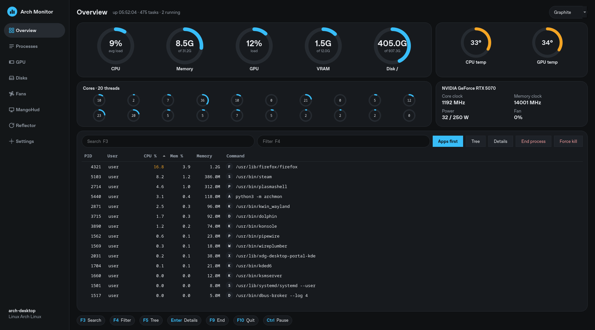

<div align="center">

<picture>
  <source media="(prefers-color-scheme: dark)" srcset="docs/images/logo-dark.svg">
  <source media="(prefers-color-scheme: light)" srcset="docs/images/logo-light.svg">
  
</picture>

<br><br>

[](#скачать-и-установить)
[](docs/DEVELOPMENT.md)
[](LICENSE.md)
[](https://github.com/QIISIT/Arch-Monitor/issues)

</div>

## Что такое Arch Monitor?

Arch Monitor — **монитор системы для Arch Linux** с интерфейсом на Qt 6.
Процессы, процессор, память, видеокарта, диски и вентиляторы — в одном окне.
Проект ориентирован на KDE Plasma и Wayland; язык интерфейса — английский.


<p align="center"><i>Тема Graphite · демонстрационные показания</i></p>

[](docs/DEVELOPMENT.md)
[](https://www.qt.io)
[](install-archmon.sh)

## Что умеет

- **Показывает нагрузку.** Общая загрузка CPU и каждого потока, память, место на диске,
  температуры и доступные показатели GPU. NVIDIA читается через `nvidia-smi`, AMD —
  через sysfs; для Intel доступно отображение частоты.
- **Помогает разобраться с процессами.** Поиск, фильтры, сортировка, дерево,
  режим Apps first, подробности и завершение выбранного процесса.
- **Следит за дисками.** Разделы, свободное место и скорость чтения и записи.
- **Управляет вентиляторами платы.** Обороты, кривые и пресеты для каналов,
  которые поддерживает драйвер hwmon. Возврат исходного режима проверяется.
- **Настраивает MangoHud.** Параметры оверлея, запуск программ и просмотр CSV-логов
  с графиком времени кадра и статистикой замеров.
- **Обновляет зеркала.** Запускает Reflector с системной настройкой и показывает результат.
- **Подстраивается под тебя.** Шесть тем, системный трей, сохранение настроек
  и приостановка обновления при зажатом Ctrl.

## Скачать и установить

**[Открыть install-archmon.sh →](install-archmon.sh)** — скачай файл кнопкой
**Download raw file**, затем открой терминал в папке со скачанным файлом:

```bash
bash install-archmon.sh
~/.local/bin/archmon
```

Установщик проверит встроенный архив, установит необходимые пакеты через `pacman`
и добавит Arch Monitor в меню приложений. Повторный запуск обновляет программу.
Само приложение запускается от обычного пользователя.

| Для чего | Что требуется |
|---|---|
| Основное окно | `python-pyqt6`, `python-psutil`, `qt6-svg` — устанавливаются автоматически |
| Показатели NVIDIA | Работающий `nvidia-smi` из установленного драйвера |
| Вентиляторы платы | Драйвер hwmon с поддержкой нужного чипа; для управления — systemd и polkit |
| Игровой оверлей | Отдельно установленный MangoHud |
| Обновление зеркал | Reflector и его системный конфиг |

Управление вентиляторами включается отдельно кнопкой **Apply** на странице Fans.
Кнопка **Back to BIOS** возвращает режимы, сохранённые перед включением управления.

### Удаление

```bash
bash install-archmon.sh --remove
```

Если служба вентиляторов была установлена, удаление сначала останавливает её
и проверяет восстановление исходных режимов. При ошибке файлы сохраняются для повторной попытки.

## Для разработчиков

Запуск из исходников, сборка установщика, устройство кода и проверки —
в [docs/DEVELOPMENT.md](docs/DEVELOPMENT.md).
Последние исправления — в [CHANGES.md](CHANGES.md).

## Лицензия

© 2026 Qisit. Arch Monitor распространяется под
[GNU General Public License v3.0](LICENSE.md) (**GPL-3.0-only**).
Разрешены использование, изменение и распространение, включая коммерческое,
при соблюдении GPLv3. При распространении программы и производных версий
сохраняйте предусмотренные лицензией права получателей и предоставляйте
соответствующие исходники согласно её условиям.

Программа предоставляется без гарантий. У зависимостей свои лицензии:
см. [THIRD-PARTY.md](THIRD-PARTY.md).

---

**English.** Arch Monitor is a Qt 6 system monitor for Arch Linux, designed for KDE Plasma
and Wayland. It includes processes, CPU and GPU statistics, disks, motherboard fan control,
MangoHud settings and Reflector integration. English UI, six themes and a system tray.
See the [installer](install-archmon.sh), [development guide](docs/DEVELOPMENT.md)
and [dependency licensing notes](THIRD-PARTY.md). Licensed under GNU GPL v3.0 only.
